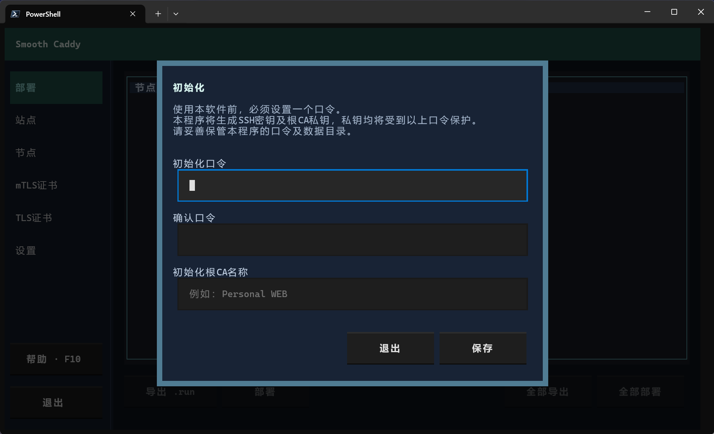
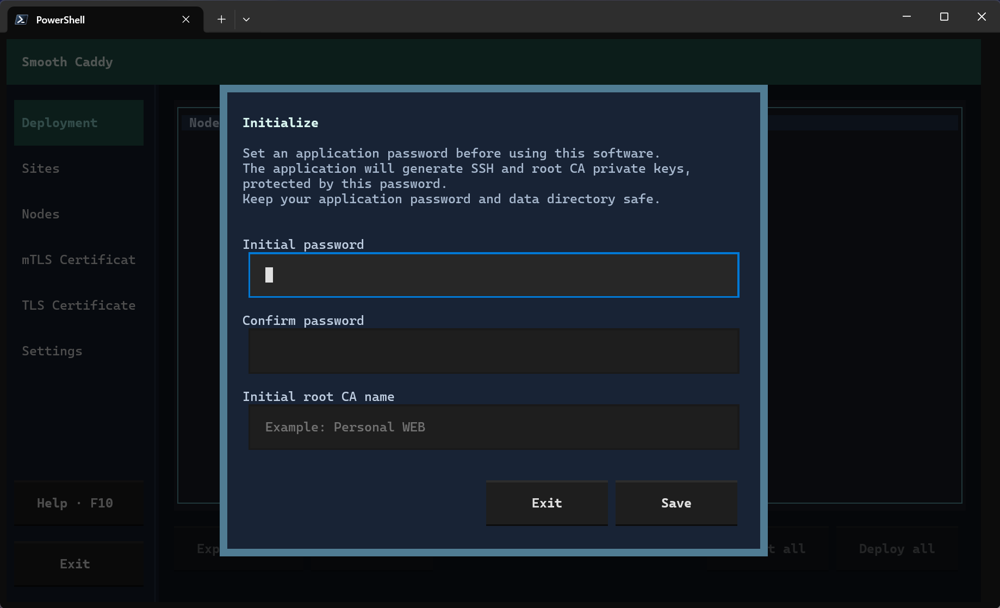
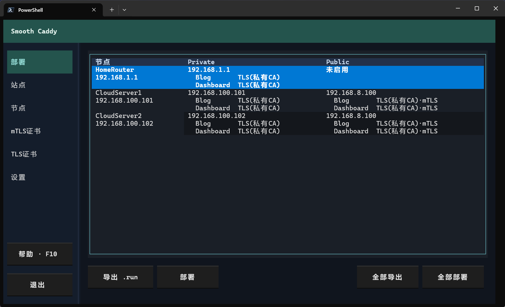
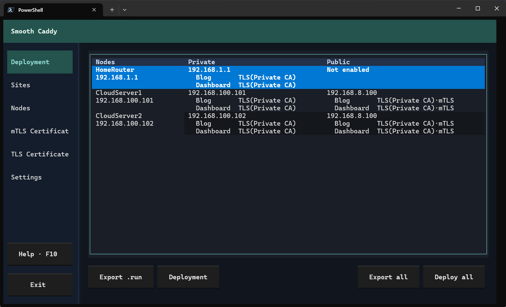
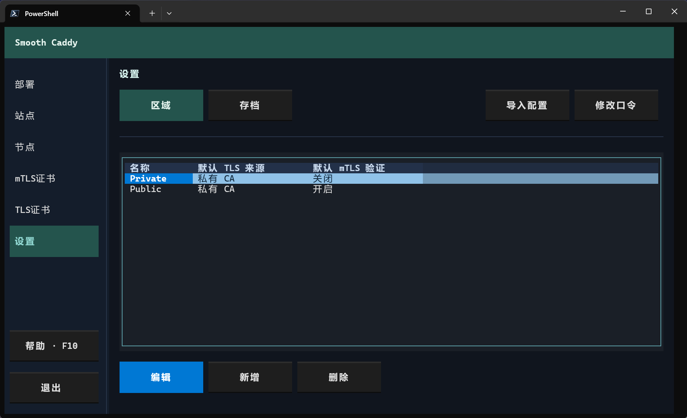
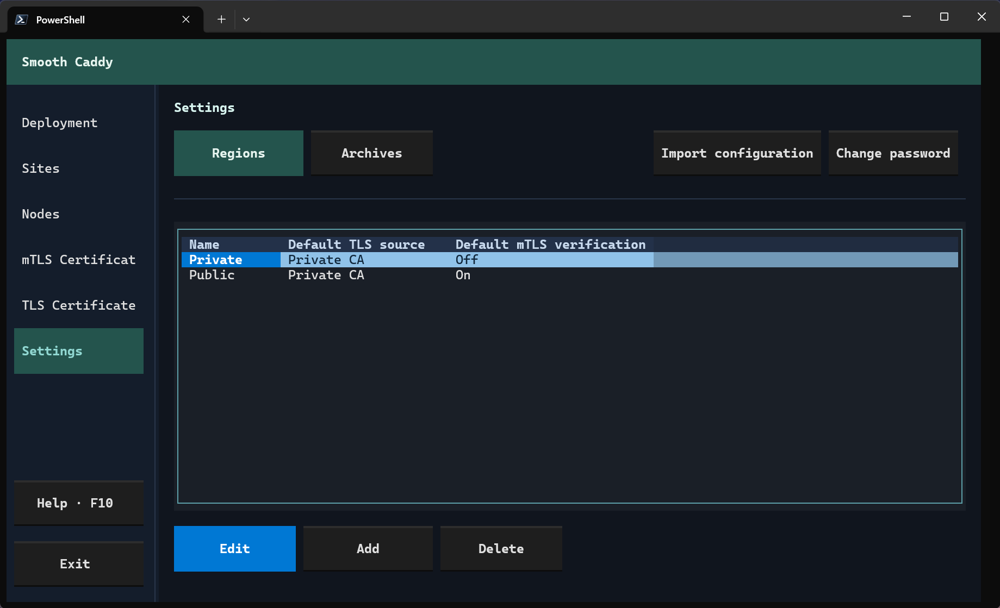
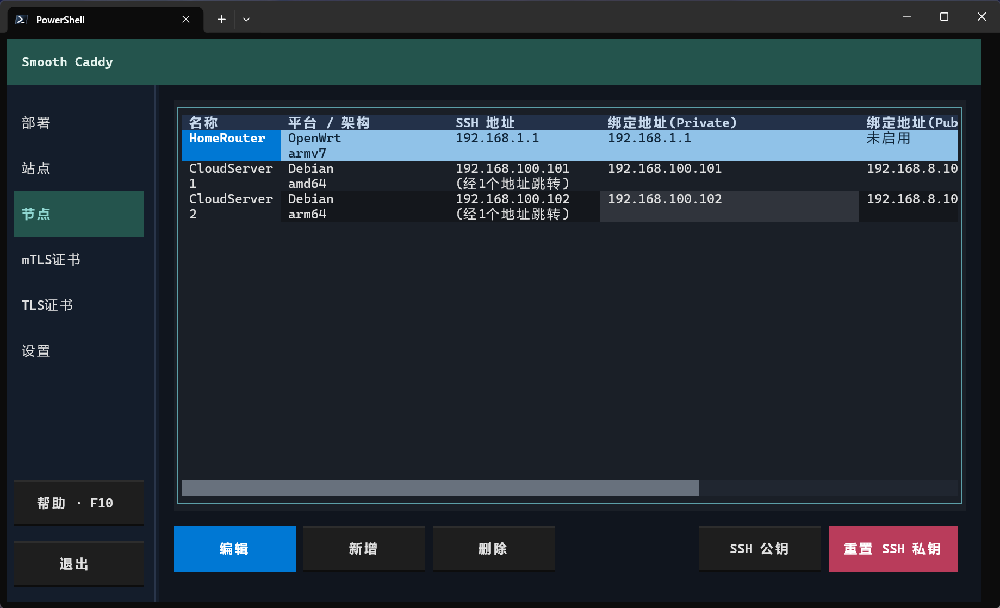
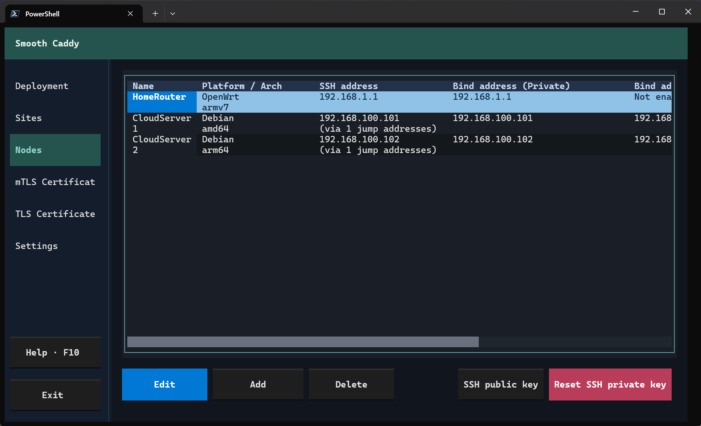
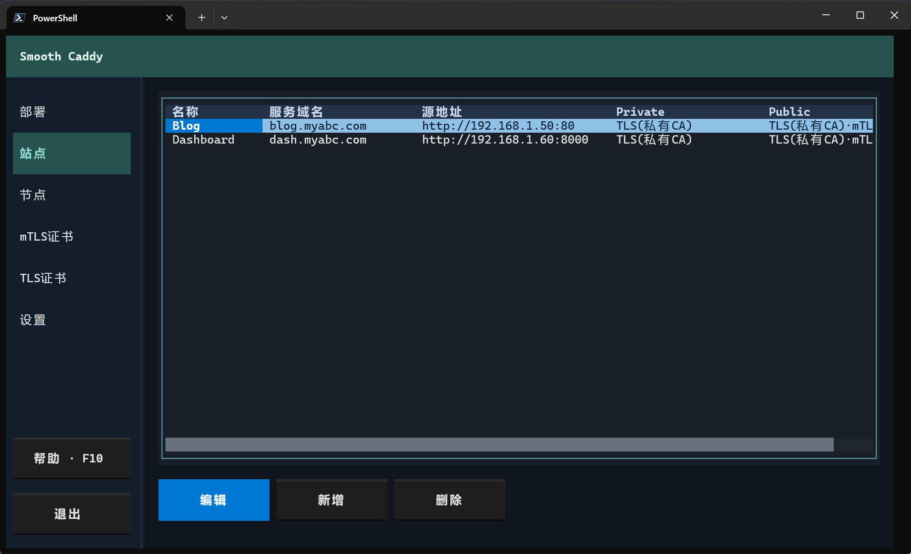
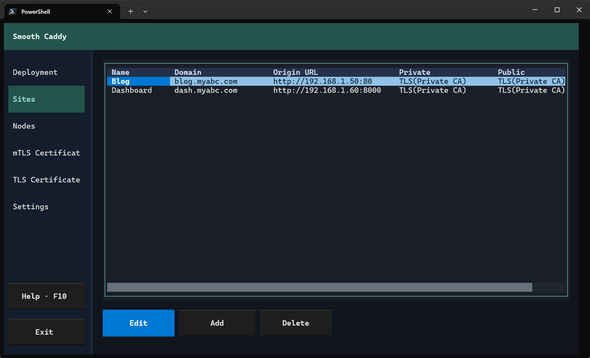

# 使用指南

[返回首页](../README.md) · [开发与发布](development.md) · [详细产品规则](product.md)

## 下载与启动

从 [GitHub Releases](https://github.com/JerryFecl3/smooth-caddy/releases/latest) 下载适合本机的压缩包，解压后运行其中的程序，无需安装 Python。提供 Linux x64 和 Windows x64；Linux 发布包要求 glibc 2.35 或更新版本。源码运行见[开发指南](development.md#从源码运行)。

程序运行在管理电脑上，被管理的 Caddy 节点支持 Debian 13（systemd）和 OpenWrt 25.12（procd）。节点架构可选择 amd64、arm64、armv7、386，与管理电脑的架构无关。

首次启动按提示设置程序口令并创建私有 CA，同时生成专用 SSH 密钥。即使站点使用公共 CA，中继仍需要私有 CA。中途返回会退出，下次启动继续初始化。初始示例中，内网与外网均使用私有 CA，内网关闭 mTLS，外网开启 mTLS；请按实际网络修改示例配置。

建议使用约 140 列 × 40 行或更大的终端。程序无需常驻，修改配置和更新证书时启动即可；节点上的 Caddy 独立运行。

<details>
<summary>初始化截图 / Screenshots</summary>

中文：



English:



</details>

## 启动与语言

默认数据目录是当前用户主目录下的 `~/.smooth-caddy/`，与程序位置和启动目录无关。可用 `--data-dir /path/to/data` 指定其他目录；这不会改变导出目录。

界面自动跟随系统语言：所有中文语言环境显示简体中文，其余语言或无法识别时显示英文。Windows 读取用户显示语言；Linux 依次检查 `LC_ALL`、`LC_MESSAGES`、`LANG`。不保存语言偏好，也不提供切换按钮。可用 `--language en` 或 `--language zh-CN` 仅覆盖本次启动；用户输入的名称、域名及外部工具输出不翻译。

## 页面与操作

| 页面 | 用途 |
| --- | --- |
| 部署（F1） | 当前配置总览；针对选中节点或全部节点部署、导出 .run |
| 站点（F2） | 域名、源地址及各区域的服务策略 |
| 节点（F3） | 平台、架构、绑定地址、上游和 SSH 地址 |
| mTLS证书（F4） | 用户 Client 证书与私有 CA 管理 |
| TLS证书（F5） | Let’s Encrypt 证书、DNS 凭据和 lego 工具 |
| 设置（F6） | 区域、存档、导入配置和修改口令 |

默认进入部署页。Tab 在操作区域之间移动，方向键在当前区域内移动，Enter 操作当前控件，Esc 返回。F7／F8 在节点、站点、区域和 TLS 列表中上移／下移条目；F10 循环展示快捷键和帮助。

部署页与存档列表不设回车默认操作。部署页左侧按钮针对选中节点，右侧按钮针对全部节点。部署总览沿用节点、区域和站点各自的配置顺序。

<details>
<summary>部署总览截图 / Screenshots</summary>

中文：



English:



</details>

## 配置第一个网络

1. **设置 → 区域**：设置默认 CA 来源（私有／公共）和 mTLS 开关。区域只提供默认服务策略。
2. **节点**：选择平台与架构，启用需要的区域，逐行填写绑定 IP。`0.0.0.0` 仅监听 IPv4，`::` 仅监听 IPv6。默认 HTTP 跳转／HTTPS／中继端口为 80／443／8443，可按节点和区域独立覆盖；同一区域的多个地址共用一组端口。
3. **SSH 地址**：每行一个 IP，按跳板到目标的顺序填写，最后一行是目标节点；不经过跳板时只填目标 IP。此项必填，与业务上游独立。
4. **业务上游**：选择“直连”时访问站点源地址；选择“中继”时填写实际可达的 HTTPS 地址和端口，必须指向已有中继服务。地址可以与上游节点的绑定地址不同；程序不检测转发环路。
5. **站点**：填写唯一域名和不带路径的源地址 URL，启用相应区域。默认继承区域策略，勾选自定义配置后可独立选择 CA 来源和 mTLS。源地址内的“校验 HTTPS 源证书”按站点独立设置，新站点默认关闭。
6. **证书**：使用私有网站证书时，将导出的信任 CA 安装到访问设备；开启 mTLS 时，还需签发并向访问设备安装 Client 的 P12。使用公共 CA 时，按下一节准备公共 TLS。
7. **部署**：授权 SSH 公钥，检查配置，选择节点部署或全部部署，再选择 Caddy 版本。

所有对外站点服务均为 HTTPS，HTTP 端口只用于跳转。可暂存不完整配置，表格和导航会标记错误；修正后才能部署或导出。SSH 地址编辑时必须通过格式检查才能保存。

<details>
<summary>设置与区域截图 / Screenshots</summary>

中文：



English:



</details>

<details>
<summary>节点截图 / Screenshots</summary>

中文：



English:



</details>

<details>
<summary>站点截图 / Screenshots</summary>

中文：



English:



</details>

## 证书管理

私有 CA 在首次启动创建，之后可在“mTLS证书 → CA 管理”重新初始化。名称作为 Root CA、TLS CA、mTLS CA、Relay CA 的共同前缀。网站信任、用户认证和中继认证分别使用对应证书体系；用户 Client 证书不能用于中继。

公共 TLS 目前支持 Let’s Encrypt，DNS 服务商支持阿里云和 DNSPod。在“TLS证书”填写域名、通配选项及每条记录独立的 DNS 凭据，并在 lego 管理中下载工具。

**默认使用测试服务器，测试证书不受系统默认信任。** 正式使用前切换环境；测试与正式环境共用域名和 DNS 凭据，但证书、私钥及申请状态隔离。本机需要访问 CA 和 DNS API，DNS 凭据不会分发给代理节点。申请会接受 Let’s Encrypt 的[订户协议](https://letsencrypt.org/repository/)。

部署与 .run 导出只申请或续签所选节点实际需要的公共证书，精确域名优先于一级通配；“全部申请”处理当前环境的全部记录。**没有后台定时续期，需要主动重新部署以更新节点证书。**

## SSH 部署与离线包

SSH 固定使用 root 和 22 端口。通过“SSH 公钥”查看授权方法，按填写的路径逐跳连接。每一跳首次连接或公钥变化时需确认指纹；信任记录按路径前缀保存，相同内网 IP 经不同跳板到达时分别确认。

部署始终使用当前界面加载的配置，先准备证书和配置，再探测各节点的 Caddy。版本、架构匹配且二进制存在时仅上传配置，否则携带完整二进制。探测失败可重试或停止，上传／部署失败可重试、跳过或停止；停止不回滚已完成操作。

导出 .run 使用同一套当前配置生成流程，始终包含完整 Caddy 二进制，并以单独设置的导出口令加密。复制到目标机后执行：

```sh
sh 文件.run
```

目标机需要 `openssl` 并交互输入导出口令。SSH 自动部署使用未加密的临时包，通过 SSH 加密传输，不要求输入导出口令。两种方式都需要系统级权限，不自动 sudo，服务目前以 root 运行；使用程序管理的官方 Caddy 二进制，不依赖 apt/apk 的 Caddy 包，也不需要目标机联网下载 Caddy。

本机临时包在操作结束后清理；全部节点成功时尝试清理远端上传包，失败、跳过或停止时保留远端现场。失败弹窗会附带最近服务日志，它们可能来自原先运行的服务。

目标机保留当前及最近成功配置（合计最多五份），失败现场保留；Caddy 二进制按版本复用，不自动清理。可手动查看与切换：

```sh
# Debian；OpenWrt 改用 /usr/lib/smooth-caddy/manage
/usr/local/lib/smooth-caddy/manage list
/usr/local/lib/smooth-caddy/manage switch <运行标识>
```

运行标识由时间戳与随机后缀组成，区别于程序发布版本和 Caddy 版本。完整远端路径见[固定文件布局](product.md#固定文件布局)。

## 设置存档与 JSON

存档位于“设置 → 存档”，保存在数据库中。可新增存档、载入、删除或导出选中存档；导出 JSON 默认保存到 `~/smooth-caddy-export/settings/`，可以修改路径。要导出当前设置，先新增存档，再导出该条目。

“导入配置”位于设置页顶部，导入后直接替换当前设置，不创建新存档。载入与导入均需确认，**不会自动另存旧设置**；需要保留时请事先新增存档。

存档和 JSON 使用相同数据规则：包含站点、节点、区域的配置及顺序，支持不完整草稿；不包含 TLS/mTLS 证书管理配置、证书、私钥、DNS 凭据或 SSH 身份与主机信任记录。站点与区域中的 CA 来源、mTLS 开关作为服务策略保留。

存档是设置快照，不是待部署包。要部署存档内容，先载入到当前界面，检查有效性，再部署或导出 .run。完整备份需要复制数据目录。

## 数据、口令与备份

| 路径（相对于数据目录） | 内容 |
| --- | --- |
| `smooth-caddy.db` | 配置、私有 CA、Client、公共 TLS 材料、DNS 凭据、SSH 身份与主机信任记录 |
| `tool_caddy/releases.json` | 官方版本列表缓存 |
| `tool_caddy/` | Caddy 二进制缓存 |
| `tool_lego/lego` | 本机申请公共证书使用的 lego 工具 |
| `releases/` | 升级前旧批次原文件，仅提取设置迁入存档，不再新增 |
| `.tmp/` | 下载、解压、部署和导出等临时文件 |
| `backups/` | 数据库格式迁移前的完整备份，不自动清理 |

P12 与信任 CA 固定导出到 `~/smooth-caddy-export/`，离线部署包导出到其 `packages/` 子目录；使用 `--data-dir` 不改变导出位置。导出目录在导出时创建，界面显示完整路径。Windows 对应用户目录下的 `.smooth-caddy` 与 `smooth-caddy-export` 文件夹，不位于 Documents 内。信任 CA 是根证书的 DER `.cer`，不含私钥；P12 包含用户证书、私钥和证书链，使用独立导出口令。

持久私钥、DNS 凭据和 ACME 私密状态由同一个程序口令加密。验证后解锁至进程退出，配置本身不加密；修改配置也需解锁。重置 SSH 私钥、重新初始化 CA 另需危险确认和再次验证口令。

旧批次材料保留原加密方式；新设置存档不包含生成材料。SSH 部署临时包和目标机运行材料含明文私钥，离线导出包使用独立导出口令加密。

搬迁或备份前退出程序，复制整个数据目录；源码运行时在新环境重建虚拟环境，不直接复制 `.venv/`。数据目录可以整体迁移。

## 升级与旧数据

退出程序后替换可执行文件，保留数据目录。升级前建议备份整个数据目录。各版本变化见 [Release 说明](https://github.com/JerryFecl3/smooth-caddy/releases)。

如果旧版本的数据仍保存在 `data/`，需在退出程序的情况下，将该目录 内的全部内容（包括隐藏文件）复制到 `~/.smooth-caddy/`，不要复制成 `~/.smooth-caddy/data/`；也可通过 `--data-dir` 继续使用原目录。旧 `export/` 中需保留的文件可另行复制到 `~/smooth-caddy-export/`。程序不自动迁移旧目录。

以首次正式发布的数据格式为兼容基线，不追溯支持所有开发期格式。后续数据结构升级允许并要求明确的版本迁移，迁移前备份；遇到更新版本的数据应拒绝写入。当前数据库格式为 10：打开正式发布的版本 2、3、4、5、6、7、8 或 9 数据库时，先在数据目录的 `backups/` 内生成完整 SQLite 备份，再以事务转换配置及 SSH 路径并升级版本；失败回滚，备份失败则不迁移。升级前退出所有旧程序。版本 1 等开发期格式仍需一次性转换，更新版本的数据库拒绝写入。旧程序不能打开升级后的数据库。如需回退，退出程序后在独立目录恢复 `backups/smooth-caddy-v<旧版本>-<唯一标识>.db` 为 `smooth-caddy.db`，配合升级前备份的批次目录使用；新格式批次不能交给旧程序读取。

绑定地址升级将原单个 IP 转为地址列表，端口仍共用一组；跨区域监听冲突会同时标记双方并阻止生成。

上游地址迁移会将旧节点／区域引用展开为 HTTPS URL，失效引用标错而不自动直达源地址。中继使用专用 Relay CA 和固定 TLS 名称 `relay.smooth-caddy.internal`，不绑定具体节点证书；有效中继客户端可自由互联，用户证书不能用于中继。删除节点不撤销已签发证书，自由 URL 不做环路检测。已有批次不改写；新旧中继认证配置不保证互通，须重新生成并在维护窗口协调部署全部相关节点。

SSH 升级会将旧业务关系推导的路径展开为独立路径；缺少地址、上游丢失或循环等无法完整展开的路径置空并标记错误，需要补全。旧批次 metadata 格式 1～5 经校验后只提取设置，一次性转为数据库存档；原文件不改写。主机信任改为按连接路径前缀区分；旧节点主机记录保留但不自动套用，升级后首次逐跳连接需要重新确认指纹。
